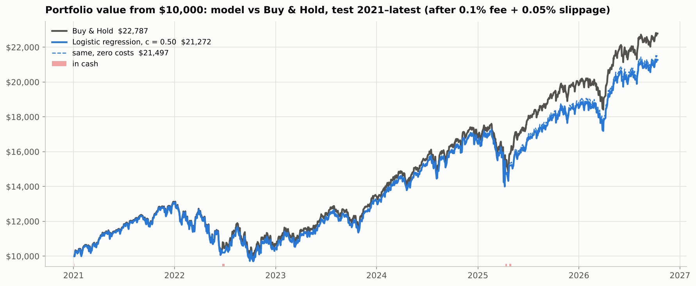

# SPY Buy / Sell / Hold Classifier

SCTP Data Science, Module 3 project. The question: **can a classifier predict whether SPY will rise more than 1% (Buy), fall more than 1% (Sell) or stay in between (Hold) over the next 5 trading days, and does trading on it beat Buy & Hold after costs?**

## Result

| | Chosen model: logistic regression, Sell only if P(Sell) ≥ 0.50 | Buy & Hold |
|---|---|---|
| Test period | 4 Jan 2021 → 9 Oct 2026 (untouched until the end) | same days |
| Macro-F1 (dummy: 0.341) | **0.399** | n/a |
| $10,000 becomes | **$21,272** | **$22,787** |
| Total return / CAGR | +112.7% / 14.0% | +127.9% / 15.3% |
| Sharpe / max drawdown | 0.88 / −25.8% | 0.95 / −24.5% |
| Trades / costs paid | 7 / $135 | 1 / $15 |
| Years won | 0 of 6 (3 tied) | n/a |

The classifier has real but small skill: it is better than the dummy, and mostly at spotting calm weeks. After costs it **does not beat Buy & Hold** on the untouched test, even though it did in validation (2005–2020), mostly by stepping aside in the 2008 crash. See [`reports/lessons_learned.md`](reports/lessons_learned.md).



## Method

| Step | Choice |
|---|---|
| Data | SPY daily OHLCV from Yahoo Finance (`yfinance`), Jan 1993 to Oct 2026. Open, high and low are adjusted with the Adj Close factor, so returns include dividends |
| Features (14) | Returns over 1, 5, 10 and 20 days; Close/SMA20, Close/SMA50, SMA50/SMA200; RSI(14); MACD histogram; Bollinger %B and width; 20-day volatility; ATR(14); volume ratio. Each uses only data up to that day's close |
| Target | 5-day forward return: above +1% is Buy, below −1% is Sell, otherwise Hold (overall share 36% / 40% / 24%) |
| Models | Dummy, K-nearest neighbours, logistic regression, decision tree, random forest, HistGradientBoosting, XGBoost, perceptron, MLP (all scikit-learn Pipelines) |
| Class imbalance | `class_weight="balanced"`, balanced sample weights (XGBoost), or oversampling of training folds only (KNN, MLP) |
| Validation | Walk-forward by year, 2005–2020: each year predicted by a model trained only on earlier years, with a 5-row gap |
| Tuning | Inside each year: `TimeSeriesSplit(n_splits=5, test_size=252, gap=5)`, randomized search, scored by macro-F1 |
| Selection | Shortlist the top 3 by macro-F1. Then pick the model and Sell cut-off by excess return, years won and median Sharpe in a 2005–2020 backtest |
| Test | 2021 → latest, run once with the frozen recipe (retrained each year) |
| Backtest | `vectorbt`. Signal at the close, trade at the next day's open, 100% SPY or 100% cash, 0.1% fee + 0.05% slippage per trade, vs Buy & Hold over the same days |

### Validation summary, 2005–2020

| Model | Macro-F1 | Balanced acc. | Accuracy |
|---|---|---|---|
| MLP | 0.423 | 0.431 | 0.466 |
| Random forest | 0.421 | 0.430 | 0.468 |
| Logistic regression | 0.421 | 0.432 | 0.483 |
| K-nearest neighbours | 0.414 | 0.423 | 0.461 |
| Decision tree | 0.400 | 0.404 | 0.434 |
| XGBoost | 0.399 | 0.402 | 0.439 |
| HistGradientBoosting | 0.391 | 0.392 | 0.423 |
| Perceptron | 0.357 | 0.356 | 0.380 |
| Dummy | 0.340 | 0.341 | 0.354 |
| Always predict Buy | 0.171 | 0.333 | 0.346 |

## Look-ahead checks

`tests/test_no_lookahead.py` (run `python -m pytest -q`) checks that:

- every feature is unchanged when future rows are deleted (25 random cut points),
- labels look exactly 5 rows ahead,
- walk-forward and inner folds never train on later data and keep a 5-row gap,
- trades happen the day after the signal,
- vectorbt matches a plain-Python re-implementation of the same backtest.

## Repository

```
├── data/spy_daily.csv          frozen snapshot (raw yfinance columns)
├── src/
│   ├── data.py                 load (yfinance first, CSV fallback) + adjustment + checks
│   ├── features.py             the 14 features
│   ├── labels.py               Buy / Hold / Sell target
│   ├── splits.py               walk-forward folds + inner TimeSeriesSplit
│   ├── models.py               9 pipelines, search spaces, walk-forward runner
│   ├── backtest.py             vectorbt backtest, signal rule, yearly / quarterly tables
│   └── plotting.py             shared chart style
├── notebooks/
│   ├── 01_eda.ipynb            data checks, distributions, correlations, class balance
│   ├── 02_modelling.ipynb      pipeline, tuning, comparison, settings, shortlist, importance
│   └── 03_backtest.ipynb       model pick, untouched test, portfolio vs Buy & Hold
├── tests/test_no_lookahead.py
├── results/                    cached predictions, tuning logs, summaries
├── figures/                    all charts
└── reports/lessons_learned.md
```

## How to run

```bash
pip install -r requirements.txt
python -m pytest -q                      # look-ahead tests
jupyter nbconvert --to notebook --execute --inplace notebooks/01_eda.ipynb
jupyter nbconvert --to notebook --execute --inplace notebooks/02_modelling.ipynb   # ~1 hour first time; cached after
jupyter nbconvert --to notebook --execute --inplace notebooks/03_backtest.ipynb
```

The notebooks use the frozen snapshot `data/spy_daily.csv`. If it's missing, they download SPY with `yfinance` and save a new snapshot. To re-run on fresh data, delete the CSV and the `results/` files. New data will change the numbers.
